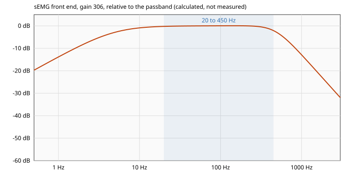

# emb-neurotech-prosthetic-arm

> **Status: software complete and tested in simulation. No hardware exists.**
> The kinematics, dynamics, trajectory planning, ROS 2 control stack and
> STM32H743 firmware are written and tested. The sEMG analogue front end and
> the servo driver are designed and their budgets calculated. **No board has
> been fabricated, no arm has been manufactured, no firmware has run on
> silicon and nothing in this repository has been measured on hardware.**
> See [STATUS.md](STATUS.md) for the precise breakdown.

> **This is a research prototype, not a medical device.** It has never been
> worn and must not be. [`docs/CLINICAL_LIMITATIONS.md`](docs/CLINICAL_LIMITATIONS.md)
> says what that means and what would have to change.

Design files imported from [`A1DevKit`](https://github.com/CGainsWorks/A1DevKit)
and [`OpenEMG`](https://github.com/CGainsWorks/OpenEMG), which remain the
original working repositories.

A six-axis myoelectric prosthetic arm, end to end in one repository: the
analogue front end that would acquire the sEMG, the firmware that conditions
it and drives the servos, the C++ kinematics and dynamics and the ROS 2 stack
that turns a gesture class into a movement.



```bash
make demo          # everything, from a clean checkout, in about four minutes
make docker-up     # the same thing in a container, needing only Docker
```

---

## What it does

A scripted sequence of gesture decisions goes in one end and the arm moves at
the other, through the real control stack, the real wire protocol and the real
kinematics. The board and the wearer are simulated; nothing else is.

```bash
make sim
```

From [`analysis/sim/control_loop_sim.json`](analysis/sim/control_loop_sim.json),
over a 14 second run:

| | |
|---|---|
| Gesture decisions consumed | 280, of which 28 were deliberately wrong at high confidence |
| Movements performed | 7 |
| Frames carried | 2,800 sEMG, 1,400 telemetry, 1,400 IMU |
| Frame decode errors | 0 |
| Tracking error, median | 0.011 rad (0.6°) |
| Tracking error, p99 | 0.054 rad (3.1°) |
| Slowest movement, decision to rest | 1,679 ms |
| Peak shoulder torque | 6.28 N·m against an 8 N·m actuator |

The 28 wrong decisions are the point. The classifier this arm is designed
around is 82% accurate with a 7% false activation rate, which is a spurious
movement every fifteen seconds. The confidence gate and the 150 ms dwell in
[`arm_control`](ros2_ws/src/arm_control) absorb them and the arm performs 7
movements rather than 35.

---

## What this covers

CV entries this repository is the evidence for:

- Six-axis myoelectric prosthetic arm, ROS2 control stack and C++ kinematics
  (NeuroTech Biowares)
- Custom STM32 sEMG PCB and 6-channel servo driver (NeuroTech Biowares)

---

## The pieces

| | |
|---|---|
| [`kinematics/`](kinematics) | Forward and inverse kinematics, dynamics, trajectory generation. C++17, no dependencies, 73 tests |
| [`firmware/`](firmware) | STM32H743 firmware. Portable core plus a platform layer, 91 host tests, an image that links and verifies |
| [`ros2_ws/src/`](ros2_ws/src) | Five ROS 2 packages: messages, description, control, the board bridge and bringup |
| [`hardware/semg-servo-board/`](hardware/semg-servo-board) | The analogue front end and power tree as parameterised models, with the documents they generate |
| [`docs/`](docs) | Architecture, the kinematic derivation, the timing budget, safety, clinical limitations and the classifier integration |

### Documentation worth reading first

| | |
|---|---|
| [`docs/architecture.md`](docs/architecture.md) | How the pieces fit and three decisions worth arguing about |
| [`docs/dh_parameters.md`](docs/dh_parameters.md) | The kinematic derivation, including why the wrist axes are concurrent |
| [`docs/CONTROL_LOOP_TIMING.md`](docs/CONTROL_LOOP_TIMING.md) | Contraction to movement, with every number labelled measured, simulated or estimated |
| [`docs/INTEGRATION.md`](docs/INTEGRATION.md) | The contract with the gesture classifier and the three places it does not hold |
| [`hardware/semg-servo-board/docs/noise_analysis.md`](hardware/semg-servo-board/docs/noise_analysis.md) | The noise budget and the conclusion that the amplifier and the converter are balanced |
| [`firmware/docs/BRING_UP.md`](firmware/docs/BRING_UP.md) | What to do when a board exists and which numbers stop being estimates |

---

## The numbers

Every one of these comes from a script in this repository and `make check`
verifies that the documentation still matches what those scripts produce.
None of them was measured on hardware.

### Kinematics: measured on this machine

| | |
|---|---|
| Closed-form inverse solution, median | 5.5 µs |
| Damped least squares, median | 74 µs |
| Poses solved, over 200,000 samples | 100% |
| Worst position error | 6.7 × 10⁻¹⁶ m |
| Worst orientation error | 1.8 × 10⁻¹¹ rad |
| Reach | 0.765 m |

The closed form exists because the three wrist axes were made to intersect.
That cost the wrist its deviation axis and bought an exact solution that
returns all eight branches; [`docs/dh_parameters.md`](docs/dh_parameters.md)
has the derivation and
[`analysis/kinematics_latency.json`](analysis/kinematics_latency.json) has the
timings.

### Analogue front end: calculated

| | |
|---|---|
| Gain | 305.8 (two stages, E96 resistors) |
| Band | 4.8 Hz to 477 Hz |
| Full scale at the electrode | ±4905 µV |
| Noise floor, gelled electrodes | 0.92 µV RMS |
| Noise floor, dry electrodes | 1.72 µV RMS |
| Common-mode rejection, worst case | 88 dB, limited by electrode imbalance |

The amplifier contributes 0.610 µV and the converter 0.599 µV. Neither is
worth improving on its own, which is the useful finding and is asserted as a
test rather than left as a remark.

### Power and thermal: calculated

| | |
|---|---|
| Continuous servo current the board can carry | 6.42 A |
| Firmware current trip | 8 A |
| Fuse | 15 A slow blow |
| Every actuator stalled | 10.2 A, 134 °C, a fault |
| Battery life, a typical reach | 76 minutes on 2.2 Ah |

Three protections at three speeds and the ordering is the design: a jam trips
the current protection inside a control period, sustained draw trips the
thermal one after a while and the fuse only ever sees a short.

### Firmware: built, never run

| | |
|---|---|
| Flash | 24,584 B of 2 MB |
| RAM | 15,452 B of 128 KB, leaving 113 KB above the stack |
| Host tests | 91, in under a second |
| Scheduler utilisation, budgeted | 21% against a 74% bound |

---

## Running it

### Everything

```bash
make demo
```

Needs a C++ compiler, Python 3.8 or later and ROS 2 Humble.
`./scripts/setup.sh` reports what is missing. `make docker-up` needs only
Docker.

### Pieces on their own

```bash
./kinematics/run_tests.sh      # kinematics; needs only a compiler
./firmware/run_tests.sh        # firmware core; needs only a compiler
./firmware/build_firmware.sh   # the STM32 image; needs arm-none-eabi-gcc
./firmware/verify_image.sh     # check the image is well formed
make hardware                  # the analogue and power models
make sim                       # acquisition through to actuation
make check                     # the generated files and documents still agree
```

### Watching it move

```bash
ros2 launch arm_bringup sim.launch.py
rviz2 -d ros2_ws/src/arm_description/rviz/arm.rviz
```

The same nodes, over real ROS 2 topics, against the simulated board.

---

## Why some things are the way they are

**The description is generated, not written.** The URDF comes from
[`kinematics/src/model.cpp`](kinematics/src/model.cpp) via
`scripts/generate_urdf.py` and CI regenerates it and fails on any difference.
A test walks both chains numerically over 3,000 configurations and compares
the tool pose, because the conversion from DH rows to URDF joints is the kind
of derivation that is either right or subtly wrong and reading it does not
settle which.

**The simulated board speaks the real protocol.** It decodes commands with the
firmware's own decoder and encodes telemetry with the firmware's own encoder,
so a mistake in the framing, the field order or a message length fails in
simulation exactly as it would on a cable.

**Several constants exist in two places and tests compare them.** The
analogue gain is in the firmware and in the component values; the actuator
ratings are in the kinematic model and in the thermal budget; the fault
thresholds are in the firmware and in the power model. Each pair is parsed out
of both files and compared, because a resistor changed in one place and not
the other produces readings that are quietly wrong by a factor.

**Nothing claims to be measured.** Every figure is labelled calculated,
simulated or measured and the only measured ones are host timings. The
documents say so on every table.

---

## Limitations

The short version. [`docs/CLINICAL_LIMITATIONS.md`](docs/CLINICAL_LIMITATIONS.md)
is the long one and it is the document to read before drawing any conclusion
from this repository.

- **No hardware.** No board, no arm, no measurement of any kind.
- **Not a medical device.** No quality system, no risk file, no isolation, no
  biocompatibility assessment. It must not be worn.
- **Eight channels against the classifier's sixteen.** The classifier would
  have to be retrained; [`docs/INTEGRATION.md`](docs/INTEGRATION.md) has this
  and two other gaps in the contract.
- **The 200 Hz output stream aliases.** Nyquist is 100 Hz and the band reaches
  99 Hz, so there is no transition band. The residual is bounded, quantified
  and asserted as a test rather than hidden.
- **Nine of the eighteen gesture classes move nothing.** The mechanism has no
  fingers and no wrist deviation. They are reported and deliberately not
  acted on.
- **No position feedback.** The servos have no output-shaft encoder, so the
  telemetry reports the commanded position. The tracking error quoted above is
  only knowable because this is a simulation.
- **2.2 kg.** Too heavy to wear, before the socket and the battery.

---

## Licence

MIT. See [LICENSE](LICENSE).
