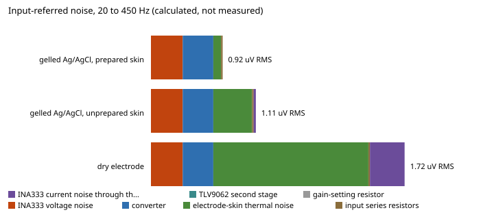

# Noise budget

> **Calculated, not measured.** No board has been fabricated and no instrument
> has ever been connected to one. Every figure below is produced by
> [`analysis/afe_model.py`](../analysis/afe_model.py) from datasheet parameters
> and stated assumptions. A measured noise floor is one of the outstanding
> items in [STATUS.md](../../../STATUS.md) and
> [`firmware/docs/BRING_UP.md`](../../../firmware/docs/BRING_UP.md) has the
> procedure for obtaining one.

Regenerate with:

```bash
python3 hardware/semg-servo-board/analysis/report.py
```



## The number

Referred to the electrode, over the channel's own response:

| Electrode | Total noise | Dominant term | SNR, light contraction (20 µV) | SNR, strong contraction (1 mV) |
|---|---|---|---|---|
| Gelled Ag/AgCl, prepared skin (10 kΩ) | **0.92 µV RMS** | INA333 voltage noise | 26.8 dB | 60.7 dB |
| Gelled Ag/AgCl, unprepared skin (50 kΩ) | 1.11 µV RMS | electrode thermal noise | 25.1 dB | 59.1 dB |
| Dry electrode (200 kΩ) | 1.72 µV RMS | electrode thermal noise | 21.3 dB | 55.3 dB |

## Where it comes from

With gelled electrodes on prepared skin:

| Source | Contribution | Share of noise power |
|---|---|---|
| INA333 voltage noise | 0.610 µV | 44% |
| Converter | 0.599 µV | 43% |
| Electrode-skin thermal noise | 0.301 µV | 11% |
| Input series resistors | 0.135 µV | 2% |
| Everything else | < 0.05 µV each | < 1% |

The two largest terms are within two percent of each other. That is what a
balanced design looks like and it is the useful conclusion: a quieter
amplifier on its own would improve the total by four percent and more bits on
its own by about the same. Improving this front end means doing both, or
neither.

`test_the_amplifier_and_the_converter_are_balanced` in
[`analysis/test_hardware_model.py`](../analysis/test_hardware_model.py) asserts
exactly that, so the conclusion cannot quietly stop being true.

## What "over the channel's own response" means

The noise bandwidth is **548 Hz**, not the 430 Hz the nominal 20 to 450 Hz band
would suggest. A two-pole roll-off passes noise above its corner that a brick
wall would not and taking the nominal band instead would understate the floor
by about a fifth, in the flattering direction.

The 1/f terms are integrated against the same response. That integral converges
at the low end only because the front end has a high pass in it, which is a fair
description of why the high pass is there.

## The assumptions and which ones matter

| Assumption | Value | If it is wrong |
|---|---|---|
| INA333 voltage noise | 25 nV/√Hz, 10 Hz corner | Datasheet typical. The corner is the uncertain one: at 30 Hz instead of 10 the total rises about 8%. |
| Converter effective noise | 4 LSB RMS at 16 bits | **The weakest assumption here.** Taken from the STM32H743 effective-number-of-bits figure, which assumes a layout this board does not yet have. At 8 LSB the converter would dominate outright. |
| Electrode impedance | 10 kΩ to 200 kΩ | Depends on skin preparation more than on anything the board does. Spans the whole plausible range. |
| Temperature | 300 K | Thermal noise goes as its square root, so this is not worth worrying about. |

The converter assumption is the one to challenge. It is the reason this design
has a plausible noise floor and a poor one is entirely possible on a first
board; measuring it is the first thing bring-up does, with the electrodes
shorted and the channel's own RMS estimator reading out over the link.

## What this floor is good for and what it is not

Surface EMG over forearm muscles is 20 µV RMS for a light contraction and up to
1 mV for a maximal one. At 0.92 µV the floor is 27 dB below the quietest useful
signal, which is enough to classify from.

It is not good enough for anything requiring individual motor unit resolution
and it is not a research-grade biopotential front end. A TI ADS1299, which is
what a serious sEMG instrument uses, would put the floor around 0.14 µV with an
eight-channel 24-bit converter and integrated programmable gain and it would
remove the analogue chain above almost entirely. It costs about twenty times
the parts here and needs an SPI driver instead of an internal ADC.

That is the revision B question and the honest answer is that the design above
is what a first board should be: cheap enough to make mistakes on and good
enough that the mistakes will be in the layout rather than in the concept.

## Full scale and where it clips

Full scale at the electrode is **±4905 µV**. A maximal contraction over forearm
flexors can reach 5 mV peak, so the very largest signals clip.

That is deliberate and it is a compromise rather than a mistake. At a gain of
500 the front end would clip at 3 mV, which is well inside the range of ordinary
contractions; at a gain of 150 nothing would clip but the signal would sit
twice as close to the converter's noise. 306 is where those two costs are
roughly equal.

The firmware detects clipping rather than ignoring it: a channel spending a
frame against a rail sets its bit in `saturated_mask`, the frame is marked
`electrode_fault` and
[`docs/INTEGRATION.md`](../../../docs/INTEGRATION.md) says the classifier must
refuse such a frame rather than classify it.

## Interference

| Path | Attenuation | 1 V of common mode becomes |
|---|---|---|
| Driven right leg, loop gain 45 | 33 dB | 21.7 mV |
| Amplifier and electrode imbalance | 88 dB worst case | 0.90 µV |
| Firmware 50 Hz notch | 34 dB measured | 0.018 µV |

The worst case is a dry electrode, where the imbalance between the two
electrodes rather than the amplifier sets the rejection. Even there the mains
term lands fifty times below the noise floor.

[`signal_conditioning.md`](signal_conditioning.md) has the three limits and why
the driven right leg is fitted regardless of which one binds.

## Measuring this, when there is a board

1. Short each channel's inputs together and to the bias rail.
2. Read `Channel::rms()` over the link. It is an exponentially weighted RMS with
   a quarter-second time constant, which is long enough to be stable and short
   enough to see a bad channel.
3. Convert with `counts_to_microvolts`, which uses the same gain constant this
   document does.
4. Compare with 0.92 µV. A first board landing within a factor of two would be
   a good result; a factor of five means the layout, not the design.
5. Repeat with electrodes on skin, which adds the electrode term and any
   movement artefact. That number is the one that matters and it will be worse.

None of this has been done.
